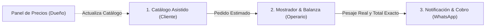

# AGENTS.md - Contexto Operativo y Reglas para Modelos de Inteligencia Artificial

> **Propósito:** Este archivo define el contexto completo, las reglas de arquitectura, los modelos de datos y las convenciones del proyecto **Mi Huerta**. Es descubierto automáticamente por agentes de IA (Antigravity) y debe ser respetado por cualquier asistente o desarrollador que modifique este repositorio.

---

## 1. Misión del Proyecto

**Mi Huerta** es un sistema digital open-source y de costo cero (\$0/mes) diseñado específicamente para **verdulerías y fruterías de barrio**.

### El Problema Principal a Resolver
En los comercios de frutas y verduras, la captura y preparación de pedidos vía WhatsApp consume la mayor parte del tiempo del dueño. A diferencia de un almacén tradicional:
1. **Los precios y el stock son volátiles:** Cambian a diario según la oferta del mercado mayorista y el estado de la mercadería.
2. **La mayoría de los productos son pesables:** El total a pagar no se conoce de antemano; se calcula recién cuando el empleado pesa físicamente el producto en la balanza del local.
3. **El dueño es un cuello de botella:** Si el dueño no está en el local, debe llamar a los empleados para averiguar precios o stock, interrumpiendo el despacho continuo.

---

## 2. Los Tres Pilares de la Solución



1. **Catálogo Web Asistido (Cliente):** El cliente entra a través de un link generado por el bot de WhatsApp (`?tel=...`). Selecciona productos por peso estimado ($250\text{ g}$, $500\text{ g}$, $1\text{ kg}$) o unidades/atados. Ve un total estimado transparente y confirma con retiro o delivery.
2. **Pantalla de Mostrador / Balanza (Operario):** Tablero Kanban móvil (`Entrantes`, `En Balanza`, `Listos`, `Cobrados`) optimizado para celulares de mostrador. El empleado ingresa el peso real de la balanza en números grandes y el sistema recalcula los subtotales automáticamente. Incluye botón "Sin Stock", edición de entrega, adición/eliminación de ítems y cancelación de pedidos.
3. **Cierre de Pedido & WhatsApp:** Al finalizar el pesaje, se calcula el precio final exacto y el microservicio en `bot/index.js` emite automáticamente el mensaje de WhatsApp al cliente con el desglose del pesaje y el Alias de pago.

---

## 3. Glosario de Dominio (Conceptos Clave de Verdulería)

* **Pesable (`unidad_medida: "KG"`):** Producto vendido por peso (Papa, Tomate, Banana, Manzana). Requiere ingreso de peso en balanza durante la preparación.
* **Unitario (`unidad_medida: "UNIDAD"`):** Producto vendido por pieza o por atado (Acelga, Espinaca, Palta, Maple de huevos). No requiere pesaje obligatorio, toma la cantidad solicitada directamente.
* **Precio Estimado:** La suma calculada en el carrito del cliente considerando pesos ideales (ej. si pidió $1\text{ kg}$ de tomate a \$2.600, estimado = \$2.600).
* **Precio Real / Final:** La suma matemática exacta tras medir en balanza física (ej. pesó $1.150\text{ kg}$ $\rightarrow$ \$2.990).
* **Merma / Sin Stock:** Fruta o verdura que se agotó en el cajón o no tiene calidad suficiente para la venta. El operario debe poder anularla del pedido con un toque sin cancelar el resto.

---

## 4. Estructura de Archivos del Proyecto

```
d:\Escritorio\miHuerta\
├── AGENTS.md                # [ESTE ARCHIVO] Reglas descubiertas automáticamente por agentes IA
├── AGENT.md                 # Copia espejo de referencia
├── README.md                # Presentación general e índice maestro de documentación
├── index.html               # Punto de entrada único con soporte local y Supabase Cloud
├── build-bundle.ps1         # Script de empaquetado de módulos JS hacia js/bundle.js
├── css/
│   └── style.css            # Tipografía Plus Jakarta Sans, animaciones y touch optimization
├── js/
│   ├── bundle.js            # Script unificado autónomo (funciona vía file:/// y web)
│   ├── app.js               # Enrutador de vistas (SPA) y protección por PIN de 4 dígitos
│   ├── store.js             # Adaptador híbrido (localStorage + Supabase Cloud/Realtime)
│   ├── products-data.js     # Catálogo base y categorías
│   └── views/
│       ├── client.js        # Vista Catálogo Cliente, auto-login ?tel= y seguimiento en vivo
│       ├── operator.js      # Vista Kanban mostrador, módulo de balanza y edición de pedidos
│       └── admin.js         # Vista Administrador de precios, stock y configuración Cloud/PIN
├── supabase/
│   └── schema.sql           # Script DDL completo de tablas, RLS, Realtime y semilla SQL
├── bot/
│   ├── package.json         # Dependencias del bot (@whiskeysockets/baileys + @supabase/supabase-js)
│   ├── .env.example         # Plantilla de variables de entorno para el bot
│   └── index.js             # Servicio de WhatsApp con QR, Cooldown de 3hs y escucha Realtime
└── docs/
    ├── 01_VISION_Y_ALCANCE.md        # Visión de negocio, métricas y roadmap
    ├── 02_PITCH_Y_COMERCIO.md        # Guion para hablar con el dueño del local
    ├── 03_ARQUITECTURA_Y_DATOS.md    # Especificación técnica, ERD y stack $0
    ├── 04_FLUJOS_Y_CASOS_BORDE.md    # Casos de uso detallados y contingencias
    └── 05_PLAN_DE_DESARROLLO_MVP.md  # Plan de desarrollo por etapas y auditoría de avance
```

---

## 5. Reglas de Diseño y Principios Obligatorios

Cualquier IA o desarrollador que modifique el código debe respetar estrictamente:

1. **Touch-friendly y Mobile-First:** El empleado de la verdulería opera con el teléfono en el mostrador. Los botones deben tener al menos $44\times 44\text{ px}$, inputs numéricos grandes (`16px` mínimo para evitar auto-zoom en iOS) y contrastes altos.
2. **Sincronización Obligatoria de `js/bundle.js` (Anti-CORS en `file:///`):**
   * Los navegadores basados en Chromium bloquean `<script type="module">` cuando se abre `index.html` con doble clic (`file:///`).
   * Por lo tanto, `index.html` carga `<script src="js/bundle.js"></script>`.
   * **REGLA ESTRICTA:** Siempre que modifiques cualquier archivo modular dentro de `js/` (`store.js`, `products-data.js`, `app.js` o `views/*.js`), **DEBES ejecutar** `powershell -ExecutionPolicy Bypass -File d:\Escritorio\miHuerta\build-bundle.ps1` antes de finalizar tu turno para mantener `js/bundle.js` sincronizado.
3. **Resiliencia de Pesaje:** El sistema **nunca** debe asumir que el cliente pagará el total estimado. Toda la arquitectura está pensada alrededor del evento de pesaje en mostrador.
4. **Costo Cero (\$0/mes):** No introducir dependencias comerciales pagas (como Twilio o WhatsApp Cloud API de pago). Las integraciones cloud deben mantenerse dentro de las capas gratuitas de **Supabase** y **Vercel/GitHub Pages**, y la integración con WhatsApp mediante **Baileys**.
5. **Flexibilidad Operativa de Pedidos:** El operario en mostrador debe poder cancelar o eliminar pedidos cancelados, quitar ítems individuales que el cliente se arrepienta de llevar, sumar productos de último momento y corregir la dirección o modalidad de entrega.
