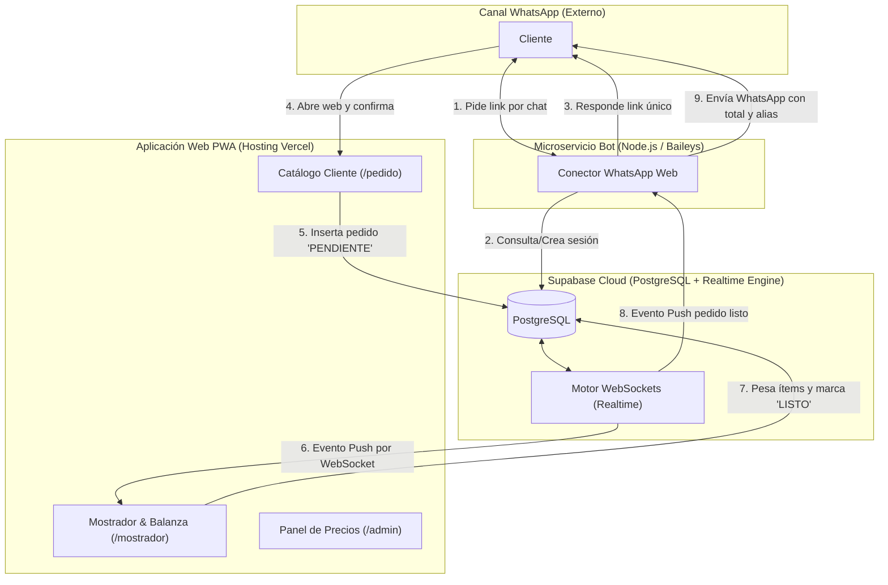
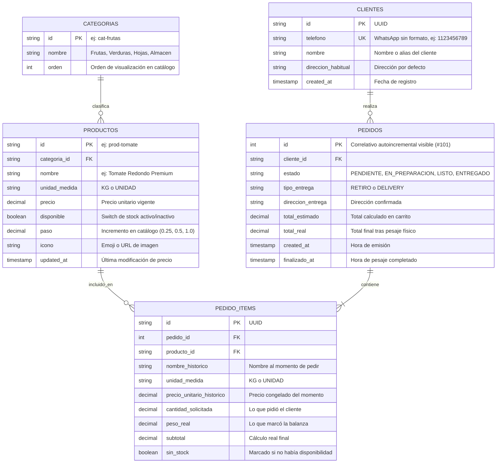
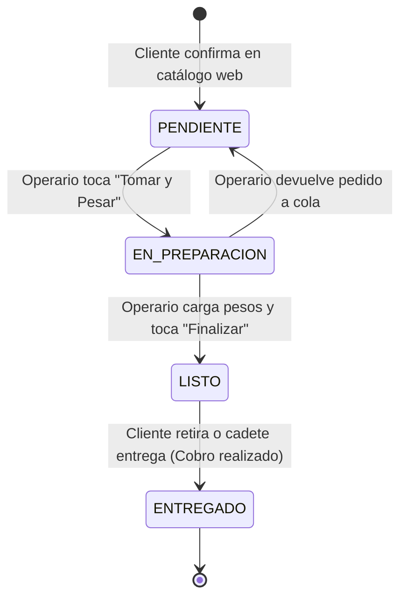

# 03 - Arquitectura del Sistema y Modelo de Datos

Este documento detalla la arquitectura técnica, las especificaciones del modelo de base de datos relacional y la estrategia de infraestructura de costo cero (\$0/mes) para **Mi Huerta**.

---

## 1. Arquitectura General del Sistema

La solución adopta un patrón **JAMstack + Backend-as-a-Service (BaaS) en Tiempo Real**, diseñado para ser ultra-liviano, escalable y 100% gratuito en volúmenes de comercio minorista barrial.



---

## 2. Modelo Entidad-Relación (ERD)



---

## 3. Especificación de Tablas SQL (PostgreSQL / Supabase)

```sql
-- 1. Tabla de Clientes
CREATE TABLE clientes (
    id UUID PRIMARY KEY DEFAULT gen_random_uuid(),
    telefono VARCHAR(20) UNIQUE NOT NULL,
    nombre VARCHAR(100) NOT NULL,
    direccion_habitual TEXT,
    created_at TIMESTAMPTZ DEFAULT NOW()
);

CREATE INDEX idx_clientes_telefono ON clientes(telefono);

-- 2. Tabla de Categorías
CREATE TABLE categorias (
    id VARCHAR(50) PRIMARY KEY,
    nombre VARCHAR(50) NOT NULL,
    orden INT DEFAULT 0
);

-- 3. Tabla de Productos
CREATE TABLE productos (
    id VARCHAR(50) PRIMARY KEY,
    categoria_id VARCHAR(50) REFERENCES categorias(id),
    nombre VARCHAR(100) NOT NULL,
    unidad_medida VARCHAR(10) NOT NULL CHECK (unidad_medida IN ('KG', 'UNIDAD')),
    precio DECIMAL(10,2) NOT NULL CHECK (precio >= 0),
    disponible BOOLEAN DEFAULT TRUE,
    paso DECIMAL(5,2) DEFAULT 0.5,
    icono VARCHAR(10),
    updated_at TIMESTAMPTZ DEFAULT NOW()
);

-- 4. Tabla de Pedidos
CREATE TABLE pedidos (
    id SERIAL PRIMARY KEY,
    cliente_id UUID REFERENCES clientes(id) NOT NULL,
    estado VARCHAR(20) DEFAULT 'PENDIENTE' CHECK (estado IN ('PENDIENTE', 'EN_PREPARACION', 'LISTO', 'ENTREGADO')),
    tipo_entrega VARCHAR(20) DEFAULT 'RETIRO' CHECK (tipo_entrega IN ('RETIRO', 'DELIVERY')),
    direccion_entrega TEXT,
    total_estimado DECIMAL(10,2) NOT NULL,
    total_real DECIMAL(10,2),
    created_at TIMESTAMPTZ DEFAULT NOW(),
    finalizado_at TIMESTAMPTZ
);

CREATE INDEX idx_pedidos_estado ON pedidos(estado);

-- 5. Tabla de Ítems del Pedido
CREATE TABLE pedido_items (
    id UUID PRIMARY KEY DEFAULT gen_random_uuid(),
    pedido_id INT REFERENCES pedidos(id) ON DELETE CASCADE,
    producto_id VARCHAR(50) REFERENCES productos(id),
    nombre_historico VARCHAR(100) NOT NULL,
    unidad_medida VARCHAR(10) NOT NULL,
    precio_unitario_historico DECIMAL(10,2) NOT NULL,
    cantidad_solicitada DECIMAL(8,3) NOT NULL,
    peso_real DECIMAL(8,3),
    subtotal DECIMAL(10,2) DEFAULT 0,
    sin_stock BOOLEAN DEFAULT FALSE
);
```

---

## 4. Máquina de Estados del Pedido



### Transiciones y Efectos Secundarios:
1. **Transición `[*] -> PENDIENTE`:**
   * Se registra el pedido con `total_estimado`.
   * El motor de Realtime emite un evento `INSERT` que hace sonar la campana en el mostrador del operario.
2. **Transición `PENDIENTE -> EN_PREPARACION`:**
   * Se bloquea la tarjeta para ese operario (evita que dos empleados pesen el mismo pedido en paralelo).
3. **Transición `EN_PREPARACION -> LISTO`:**
   * Se validan los campos `peso_real`.
   * Si un ítem fue marcado `sin_stock = true`, se excluye de la sumatoria.
   * Se congela el campo `total_real`.
   * Se emite el evento para disparar el mensaje de WhatsApp al cliente.
4. **Transición `LISTO -> ENTREGADO`:**
   * El pedido sale de la visual operativa activa y pasa al historial de ventas del día.

---

## 5. Estrategia Costo Cero ($0/mes)

Para mantener el proyecto accesible para cualquier estudiante o comercio pequeño, la arquitectura se apoya en capas gratuitas generosas de servicios estándar en la industria:

| Capacidad | Proveedor / Tecnología | Límite Gratuito | Demanda Estimada Verdulería | ¿Costo? |
| :--- | :--- | :--- | :--- | :--- |
| **Hosting Frontend** | Vercel / Cloudflare Pages | Ancho de banda ilimitado / 100 GB | ~2 GB / mes | **\$0** |
| **Base de Datos Postgres** | Supabase Free Tier | 500 MB almacenamiento | ~10 MB para 10.000 pedidos | **\$0** |
| **Conexiones Realtime** | Supabase WebSockets | 200 conexiones simultáneas | 2 a 5 conexiones (local + clientes) | **\$0** |
| **Conector WhatsApp** | `@whiskeysockets/baileys` (Open Source) | Sin límites de mensajes | ~50 a 100 pedidos diarios | **\$0** |

> [!TIP]
> **Sin costos fijos:** Esta arquitectura permite que la verdulería funcione indefinidamente sin ninguna factura mensual de infraestructura.
