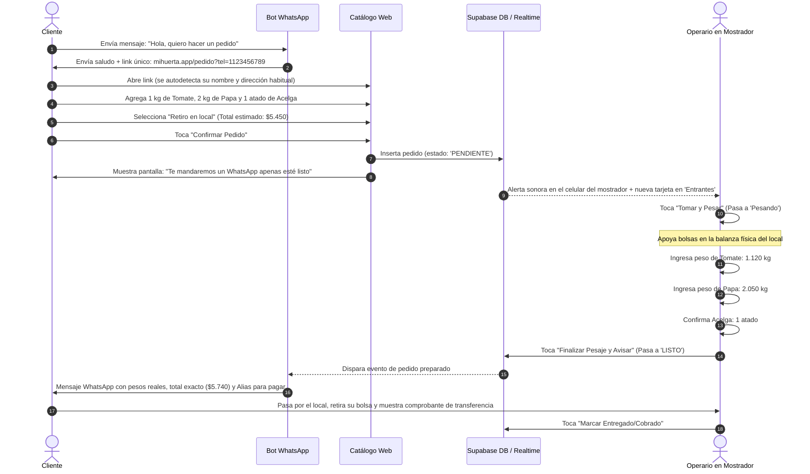

# 04 - Flujos Operativos, Casos Borde y Contingencias

Este documento define la especificación funcional detallada de **Mi Huerta**, abarcando tanto el flujo ideal ("Caminito Feliz") como las contingencias y situaciones excepcionales propias de la operativa real de una verdulería.

---

## 1. El "Caminito Feliz" Cronológico

---

## 2. Matriz de Casos Borde y Manejo de Excepciones

En la venta de frutas y verduras, las excepciones son la regla. El sistema debe responder con gracia a las siguientes situaciones:

### Caso Borde 1: Mercadería Agotada o en Mal Estado en Mostrador
* **Escenario:** El cliente pidió $1\text{ kg}$ de frutillas. Cuando el empleado va al cajón, descubre que las frutillas que quedan están pasadas y no son aptas para la venta.
* **Manejo del Sistema:**
  * Al lado del producto en la pantalla de pesaje, el operario presiona el botón **"Sin Stock / Anular"**.
  * El ítem se tacha visualmente en rojo.
  * Su subtotal pasa automáticamente a \$0.
  * El total del pedido se recalcula sin trabar el pesaje de las papas o tomates.
  * En el mensaje final de WhatsApp al cliente se aclara: *"• Frutilla Seleccionada: (Sin stock disponible en el local por hoy - \$0)"*.

### Caso Borde 2: Productos Grandes con Peso Dispar (Calabazas, Sandías, Melones)
* **Escenario:** El cliente pide "1 kg de calabaza anco", pero las calabazas enteras pesan entre $1.8\text{ kg}$ y $2.5\text{ kg}$.
* **Manejo del Sistema:**
  * En el catálogo, la calabaza aclara: *"Se pesa la pieza entera"*.
  * El empleado coloca la pieza en la balanza (ej: $1.920\text{ kg}$) e ingresa ese valor.
  * El sistema multiplica $1.920 \times \text{precio\_kilo}$ y ajusta el importe con total transparencia en el resumen final.

### Caso Borde 3: El Cliente Pide por Unidades una Fruta que se Vende por Kilo
* **Escenario:** Un cliente mayor acostumbra pedir *"dame 3 manzanas medianas"* en lugar de pedir por gramaje.
* **Manejo del Sistema:**
  * El catálogo permite elegir cantidades fraccionadas ($0.5\text{ kg}$, $1\text{ kg}$) con una nota de referencia: *(aprox. 4 manzanas por kilo)*.
  * En la balanza, el operario simplemente apoya las 3 manzanas seleccionadas y carga el peso que arroje la balanza física (ej: $0.680\text{ kg}$).

### Caso Borde 4: Corte de Conexión a Internet en el Local
* **Escenario:** El Wi-Fi de la verdulería se corta temporalmente durante la jornada.
* **Manejo del Sistema:**
  * Al ser una **PWA (Progressive Web App)** con almacenamiento local (`localStorage` / `IndexedDB`), la pantalla del operario no se cuelga ni se cierra.
  * Los pedidos que ya estaban cargados en pantalla siguen siendo editables y pesables.
  * En cuanto se restablece la conexión (o el teléfono conmuta a datos móviles 4G/5G), las actualizaciones de estado se sincronizan automáticamente con la nube.

### Caso Borde 5: El Cliente Cancela o No Pasa a Retirar
* **Escenario:** El pedido se pesó y quedó en la pestaña `Listos`, pero pasaron 4 horas y el cliente no vino a retirarlo ni responde el WhatsApp.
* **Manejo del Sistema:**
  * El operario puede tocar la tarjeta y presionar **"Cancelar Pedido / Desarmar Bolsa"**.
  * La mercadería vuelve a estar disponible para la venta en el mostrador físico.
  * El pedido queda archivado como cancelado para no ensuciar las estadísticas de caja.

### Caso Borde 6: Cambio de Precio Durante la Compra
* **Escenario:** El dueño cambia el precio del tomate de \$2.000 a \$2.600 mientras una clienta tiene el carrito abierto en su teléfono.
* **Manejo del Sistema:**
  * El precio se congela en el registro `pedido_items.precio_unitario_historico` en el instante exacto en que la clienta presiona *"Confirmar Pedido"*.
  * De esta forma, nunca se le cobra una tarifa distinta a la que vio al momento de enviar su orden, evitando quejas comerciales.

---

## 3. Lista de Criterios de Aceptación (Testing Checklist)

Para certificar que una nueva versión del sistema está lista para producción:

- [x] **Ingreso sin contraseña:** Un usuario puede ingresar escribiendo su teléfono y recupera su nombre guardado.
- [x] **Cálculo de carrito:** Los subtotales estimados suman con exactitud aritmética los pasos de $250\text{ g}$, $500\text{ g}$ y unidades.
- [x] **Tiempo real sin recargar:** Un pedido confirmado en una ventana aparece en la pestaña *Entrantes* de otra ventana sin presionar F5.
- [x] **Alerta sonora:** Se reproduce el tono sintético de dos notas al ingresar un pedido nuevo.
- [x] **Carga de balanza táctil:** El input numérico de peso real admite decimales y recalcula el subtotal en tiempo real.
- [x] **Anulación sin stock:** Marcar "Sin Stock" descuenta el ítem y no rompe el botón de finalización.
- [x] **Generador de mensaje WhatsApp:** El texto generado contiene el desglose correcto, el total final y el link con formato internacional (`https://wa.me/549...`).
