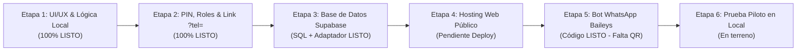

# 05 - Plan de Desarrollo del MVP y Auditoría de Estado Actual

Este documento constituye la hoja de ruta técnica y operativa para llevar **Mi Huerta** desde el prototipo funcional hasta el **Producto Mínimo Viable (MVP) operando en vivo en la verdulería**, a costo \$0/mes.

---

## 1. Mapa General de Etapas hacia el MVP



---

## 2. Auditoría: ¿Qué está hecho hoy y qué falta?

| Etapa | Componente | Estado en Código | Falta Hacer (Acción Humana / Configuración) |
| :--- | :--- | :---: | :--- |
| **1. Interfaces y Lógica** | Catálogo Cliente, Mostrador Kanban (Balanza), Edición/Cancelación de pedidos y Panel del Dueño. | **100% Completado** | Nada. Ya funciona de punta a punta y sin servidor abriendo [`index.html`](file:///d:/Escritorio/miHuerta/index.html). |
| **2. Roles, PIN y Link Mágico** | Autodetección de `?tel=`, ocultamiento de barra simulador para clientes y bloqueo por PIN (`1234`) para personal. | **100% Completado** | Opcional: cambiar el PIN `1234` por el que elija el dueño desde el panel *Precios -> Configurar PIN / Cloud*. |
| **3. Base de Datos y Realtime** | Script SQL ([`supabase/schema.sql`](file:///d:/Escritorio/miHuerta/supabase/schema.sql)) y adaptador híbrido Local/Cloud en [`js/store.js`](file:///d:/Escritorio/miHuerta/js/store.js). | **100% Completado** | Crear cuenta gratuita en Supabase, pegar `schema.sql` en el SQL Editor y cargar `SUPABASE_URL` + `ANON_KEY` en el panel. |
| **4. Hosting Público** | Web estática autónoma lista para subir a GitHub Pages, Vercel o Netlify. | **100% Preparado** | Hacer `git push origin main` y activar Vercel o GitHub Pages en 2 clics. |
| **5. Bot de WhatsApp** | Microservicio Node.js + Baileys con *cooldown* de 3 hs y escucha Realtime ([`bot/index.js`](file:///d:/Escritorio/miHuerta/bot/index.js)). | **100% Completado** | Instalar Node.js en la PC donde correrá el bot, configurar `bot/.env`, correr `npm install && npm start` y escanear el QR. |
| **6. Piloto en Verdulería** | Guion de presentación y acuerdo piloto ([`docs/02_PITCH_Y_COMERCIO.md`](file:///d:/Escritorio/miHuerta/docs/02_PITCH_Y_COMERCIO.md)). | **Documentado** | Sentarse con el dueño, actualizar precios reales del día y probar con los primeros 5 a 10 clientes. |

---

## 3. Detalle Técnico Etapa por Etapa

### Etapa 1: Interfaces y Lógica Operativa (COMPLETADA)
Todo el flujo funcional del negocio ya se encuentra programado y verificado:
* **Vista Cliente ([`js/views/client.js`](file:///d:/Escritorio/miHuerta/js/views/client.js)):**
  * Identificación sin contraseñas por número de WhatsApp.
  * Catálogo mobile-first con buscador en vivo y filtros por categoría (*Frutas*, *Verduras*, *Hojas Verdes*, *Almacén*).
  * Selectores de peso ($250\text{ g}$, $500\text{ g}$, $1\text{ kg}$) y unidades/atados con cálculo de **Total Estimado**.
  * Elección de *Retiro en Local* o *Envío a Domicilio* y pantalla de seguimiento en vivo.
* **Vista Operario / Balanza ([`js/views/operator.js`](file:///d:/Escritorio/miHuerta/js/views/operator.js)):**
  * Tablero Kanban táctil dividido en 4 columnas: `Entrantes`, `En Balanza`, `Listos` y `Cobrados`.
  * Alerta sonora sintética (Web Audio API) cuando cae un pedido nuevo.
  * Carga de peso real de balanza con recálculo instantáneo de subtotales.
  * Botón **"Sin Stock"** para anular un producto agotado en el cajón sin frenar el pedido.
  * Funciones de **Edición y Cancelación**: quitar un ítem individual (`Quitar`), sumar un producto olvidado por el cliente (`+ Agregar producto`), editar dirección/entrega y cancelar/eliminar pedidos.
* **Vista Dueño ([`js/views/admin.js`](file:///d:/Escritorio/miHuerta/js/views/admin.js)):**
  * Actualización rápida de precios por kilo/unidad y botón de pausa/activación de stock en 1 toque.

---

### Etapa 2: Separación de Roles, Link `?tel=` y Seguridad por PIN (COMPLETADA)
Implementado en [`js/app.js`](file:///d:/Escritorio/miHuerta/js/app.js) y [`js/store.js`](file:///d:/Escritorio/miHuerta/js/store.js):
1. **Link Mágico de Cliente (`?tel=1123456789`):**
   * Cuando el cliente abre el link enviado por el bot (ej. `https://tu-web.vercel.app/?tel=1123456789`), el sistema oculta automáticamente la barra negra de simulación superior.
   * Si el teléfono ya existe en la base de clientes, ingresa directamente al catálogo saludándolo por su nombre. Si es nuevo, pre-completa su número de teléfono para que sólo escriba su nombre.
2. **Protección por PIN de 4 Dígitos (`1234`):**
   * El acceso a las vistas de trabajo (`?view=operario` y `?view=admin`) solicita un PIN numérico de 4 dígitos cuando no se está en modo libre.
   * Podés probarlo ahora mismo haciendo clic en el botón **"Probar PIN"** en la barra superior de [`index.html`](file:///d:/Escritorio/miHuerta/index.html).

---

### Etapa 3: Implementación de Base de Datos Cloud en Supabase (CÓDIGO LISTO)
El sistema cuenta con un adaptador híbrido en [`js/store.js`](file:///d:/Escritorio/miHuerta/js/store.js): funciona en `localStorage` cuando no hay credenciales configuradas, y conmuta automáticamente a **PostgreSQL + Supabase Realtime WebSockets** apenas se ingresan las credenciales.

#### Pasos para activar Supabase (10 minutos):
1. Entrar a [https://supabase.com](https://supabase.com) e iniciar sesión con GitHub.
2. Crear un nuevo proyecto gratuito llamado `mi-huerta`.
3. En el menú lateral izquierdo, abrir **SQL Editor** $\rightarrow$ **New query**.
4. Copiar y pegar todo el contenido del archivo [`supabase/schema.sql`](file:///d:/Escritorio/miHuerta/supabase/schema.sql) y presionar **Run**.
   * Esto crea las tablas `clientes`, `productos` y `pedidos`, configura los permisos públicos del MVP, activa los WebSockets de `supabase_realtime` y carga los 17 productos iniciales.
5. Ir a **Project Settings** $\rightarrow$ **API** y copiar:
   * `Project URL`
   * `anon public key`
6. Abrir la pestaña **Precios (Dueño)** en la web, tocar **"Configurar PIN / Cloud"**, pegar ambos valores y guardar. ¡La web quedará conectada en tiempo real a la nube!

---

### Etapa 4: Publicación de la Web en Internet (Costo \$0)
Para que los clientes y el celular del mostrador puedan entrar desde cualquier lugar:

1. Subir los últimos commits a tu repositorio de GitHub:
   ```bash
   git push origin main
   ```
2. **Opción A - GitHub Pages (Directo desde tu repo):**
   * En GitHub, ir a `Settings` $\rightarrow$ `Pages` $\rightarrow$ en *Branch* elegir `main` / `/ (root)` y guardar.
   * En 1 minuto tu web estará online en `https://facussttee.github.io/MiHuerta/`.
3. **Opción B - Vercel:**
   * Entrar a [https://vercel.com](https://vercel.com) con tu cuenta de GitHub, importar el repositorio `MiHuerta` y darle a **Deploy** (sin configurar ningún framework, ya que es HTML/JS estático puro).

---

### Etapa 5: Puesta en Marcha del Bot de WhatsApp (CÓDIGO LISTO)
El código completo del bot ya está escrito en la carpeta [`bot/`](file:///d:/Escritorio/miHuerta/bot/index.js).

#### ¿Qué hace [`bot/index.js`](file:///d:/Escritorio/miHuerta/bot/index.js)?
* Se conecta como un dispositivo vinculado de WhatsApp Web usando `@whiskeysockets/baileys`.
* **Respuesta inteligente con Cooldown (3 horas):** Cuando un cliente escribe por primera vez en el día, le responde automáticamente con su link personalizado (`https://tu-web/?tel=11...`). Luego guarda silencio durante 180 minutos para ese número, permitiendo que el dueño o el local chateen normalmente si el cliente hace una consulta particular.
* **Aviso automático de Pedido Listo:** Escucha por WebSocket la tabla `pedidos` en Supabase. Apenas el empleado en la balanza toca *"Finalizar Pesaje y Notificar al Cliente"* (pasando el estado a `LISTO`), el bot le envía automáticamente por WhatsApp el detalle con los pesos reales de cada fruta/verdura, el total exacto y el Alias para transferir.

#### Pasos para correr el Bot en tu PC o en la PC del local:
1. Instalar **Node.js LTS** (versión 20 o superior) desde [https://nodejs.org](https://nodejs.org).
2. Abrir una terminal en la carpeta `bot`:
   ```bash
   cd d:\Escritorio\miHuerta\bot
   copy .env.example .env
   ```
3. Editar el archivo `.env` con tu `SUPABASE_URL`, `SUPABASE_ANON_KEY`, la URL de tu web (`CATALOG_WEB_URL`) y el alias de Mercado Pago de la verdulería (`PAYMENT_ALIAS`).
4. Instalar las dependencias e iniciar el bot:
   ```bash
   npm install
   npm start
   ```
5. Escanear el código QR que aparece en la consola desde el WhatsApp de la verdulería (*Dispositivos vinculados $\rightarrow$ Vincular un dispositivo*).

---

### Etapa 6: Lanzamiento del Piloto en la Verdulería
1. **Día 1 (Configuración en mostrador - 15 min):**
   * Cargar con el dueño los precios del día desde la vista `Precios`.
   * Dejar un acceso directo en la pantalla de inicio del celular del mostrador apuntando a `https://tu-web/?view=operario`.
2. **Día 2 a 7 (Primeros pedidos reales):**
   * Probar el circuito completo con los primeros clientes que escriban por WhatsApp.
   * Observar al operario mientras pesa en la balanza y anotar cualquier ajuste de comodidad visual que necesite.
