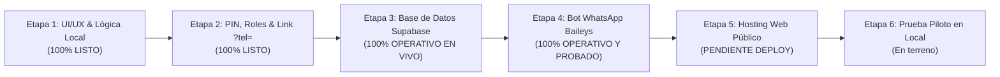
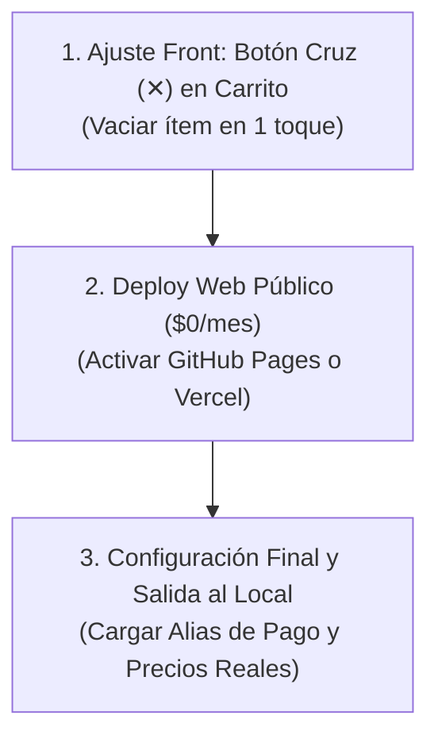

# 05 - Plan de Desarrollo del MVP y Auditoría de Estado Actual

Este documento constituye la hoja de ruta técnica y operativa para llevar **Mi Huerta** desde el prototipo funcional hasta el **Producto Mínimo Viable (MVP) operando en vivo en la verdulería**, a costo \$0/mes.

---

## 1. Mapa General de Etapas hacia el MVP



---

## 2. Auditoría: ¿Qué está hecho hoy y qué falta?

| Etapa | Componente | Estado en Código | Estado Operativo / Infraestructura |
| :--- | :--- | :---: | :---: |
| **1. Interfaces y Lógica** | Catálogo Cliente, Mostrador Kanban, Balanza con auto-conversión de gramos (`2150` $\rightarrow 2.15\text{ kg}$) y Panel Dueño. | **100% Completado** | **Probado en Android y PC**. UTF-8 corregido. |
| **2. Roles, PIN y Link Mágico** | Aislamiento estricto de vistas, ocultamiento total de barra simulación y protección por PIN (`1234`) para personal. | **100% Completado** | **Activo**. El cliente solo ve su catálogo y no accede al local. |
| **3. Base de Datos Cloud** | PostgreSQL + Realtime WebSockets en proyecto `afrvwqghnvblgjbdndnt` (São Paulo). Tablas `clientes`, `productos` y `pedidos`. | **100% Completado** | **100% Operativo**. Catálogo semilla de 17 productos cargado y sincronizado. |
| **4. Bot de WhatsApp** | Microservicio Baileys con servidor web integrado, detección Wi-Fi local, resolución JID Argentina y reconciliación. | **100% Completado** | **Conectado por QR y probado con cliente real** (Primer pedido exitoso). |
| **5. Hosting Web Público** | Código estático autónomo (`index.html` + `js/bundle.js`) preparado para Vercel o GitHub Pages. | **100% Preparado** | **Pendiente Deploy**. Falta hacer `git push` y activar GitHub Pages o Vercel. |
| **6. Piloto en Verdulería** | Guion comercial, carga de precios reales del día y Alias de Mercado Pago definitivo. | **Documentado** | **Pendiente de salida al local** (Próximo paso tras deploy). |

---

## 3. Detalle Técnico de Avances Realizados

### Etapa 1: Interfaces y Balanza de Mostrador (COMPLETADA)
* **Balanza con Conversión Inteligente de Gramos:** El operario en el puesto de balanza puede escribir directamente números enteros (ej. `2150` o `2350`) y el sistema los transforma automáticamente a kilogramos ($2.15\text{ kg}$ o $2.35\text{ kg}$) sin obligarlo a presionar el punto o la coma en el teclado táctil.
* **Aislamiento de Pedidos por Cliente:** Se incorporó `isSameCustomer` y `getActiveOrder(userPhone)`. Cada cliente ve pura y exclusivamente sus propios pedidos y seguimiento; es imposible visualizar pedidos de terceros.
* **Codificación UTF-8 Estricta:** Se eliminó cualquier vestigio de Mojibake (`á`, `−`) tanto en los módulos fuente como en el script de ensamble [`build-bundle.ps1`](file:///d:/Escritorio/miHuerta/build-bundle.ps1) y en [`index.html`](file:///d:/Escritorio/miHuerta/index.html).

### Etapa 2: Separación Estricta de las 3 Vistas (COMPLETADA)
1. **Cliente ([`index.html`](file:///d:/Escritorio/miHuerta/index.html)):** Barra negra de pruebas 100% oculta por defecto. Visual limpia y mobile-first para celulares.
2. **Operario (`?view=operario`):** Requiere PIN (`1234`). Entrada directa al tablero de mostrador, pesaje y despacho de pedidos. Botón de "Salir" para bloquear.
3. **Administrador (`?view=admin`):** Requiere PIN (`1234`). Entrada directa al cambio de precios, control de stock y configuración. Botón de "Salir".

### Etapa 3: Base de Datos y TIEMPO REAL (COMPLETADA Y ACTIVA)
* Proyecto Supabase aprovisionado en la región de menor latencia (`sa-east-1` São Paulo): `https://afrvwqghnvblgjbdndnt.supabase.co`.
* Esquema DDL en [`supabase/schema.sql`](file:///d:/Escritorio/miHuerta/supabase/schema.sql) aplicado con políticas RLS, soporte para pedidos cancelados y triggers automáticos de fecha.
* 17 productos iniciales de verdulería insertados y verificados en PostgreSQL mediante [`bot/seed.js`](file:///d:/Escritorio/miHuerta/bot/seed.js).
* Adaptador híbrido enlazado por defecto en [`js/store.js`](file:///d:/Escritorio/miHuerta/js/store.js) y [`js/bundle.js`](file:///d:/Escritorio/miHuerta/js/bundle.js).

### Etapa 4: Microservicio de WhatsApp Baileys (COMPLETADA Y VERIFICADA)
* Conexión por código QR establecida y sesión autenticada persistida en disco ([`bot/auth_info_baileys/`](file:///d:/Escritorio/miHuerta/bot/auth_info_baileys/)).
* **Servidor Web Local Integrado:** [`bot/index.js`](file:///d:/Escritorio/miHuerta/bot/index.js) ahora incluye un servidor HTTP nativo en el puerto `3000` con autodetección de IP Wi-Fi (`http://192.168.0.14:3000`), permitiendo pruebas en celulares reales sin herramientas externas.
* **Resolución de JID Argentino:** Detección de cuentas con y sin prefijo móvil (`549` vs `54`) mediante `sock.onWhatsApp` para garantizar la entrega de mensajes a celulares de todo el país.
* **Reconciliación y Resiliencia:** Si el bot se reinicia, despacha automáticamente pedidos que hayan pasado a `LISTO` durante la desconexión. Cooldown de 3 horas persistido en [`bot/.cooldowns.json`](file:///d:/Escritorio/miHuerta/bot/.cooldowns.json).

---

## 4. ¿Qué nos falta para completar el 100% del MVP?

Para dar por finalizado el proyecto técnico y operar en vivo en el comercio minorista solo restan **3 tareas puntuales**:



### Tarea 1: Ajuste UX de Frontend (En chat de Front)
* **Botón Eliminar Ítem (✕):** Agregar en el Drawer de Carrito ([`js/views/client.js`](file:///d:/Escritorio/miHuerta/js/views/client.js)) un botón con cruz o tacho para quitar un producto entero de una sola vez, sin requerir restar de a $250\text{ g}$ repetidamente.

### Tarea 2: Publicación Web Permanente a Costo \$0
Para que los clientes compren desde la calle con datos móviles 4G/5G:
1. Subir los últimos commits a GitHub:
   ```bash
   git push origin main
   ```
2. **Opción A (GitHub Pages en 2 clics):**  
   En `github.com/Facussttee/MiHuerta` $\rightarrow$ *Settings* $\rightarrow$ *Pages* $\rightarrow$ Branch `main` $\rightarrow$ Guardar.  
   Quedará online en `https://facussttee.github.io/MiHuerta/`.
3. **Opción B (Vercel):**  
   Importar el repositorio en `vercel.com` y darle a *Deploy*.
4. Actualizar en [`bot/.env`](file:///d:/Escritorio/miHuerta/bot/.env) la variable `CATALOG_WEB_URL` con ese link HTTPS definitivo.

### Tarea 3: Puesta a Punto en Terreno con el Dueño
1. Actualizar el `PAYMENT_ALIAS` en `bot/.env` con el Alias real de Mercado Pago o cuenta bancaria del local.
2. Ingresar a `?view=admin` (PIN `1234`) y repasar con el dueño los precios vigentes del día.
3. Crear un acceso directo en el celular del mostrador a `https://tu-web/?view=operario`.
